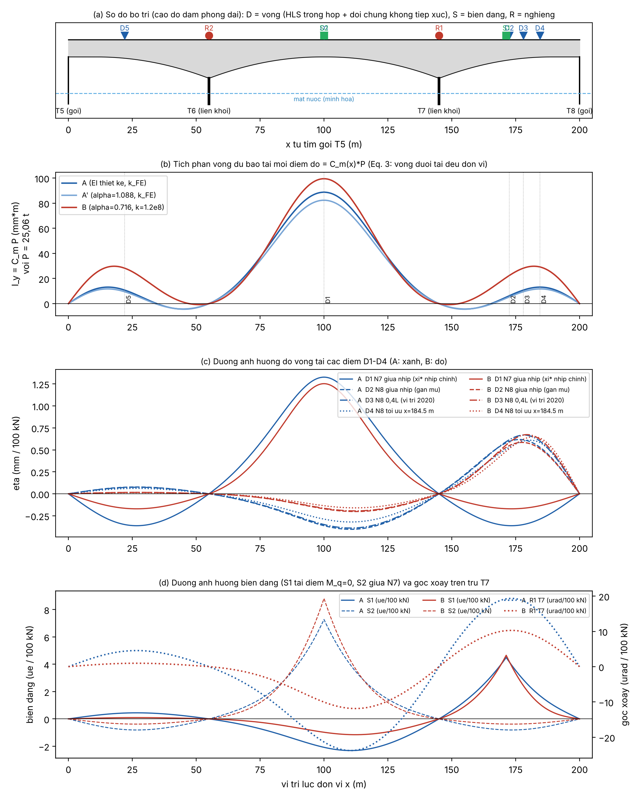
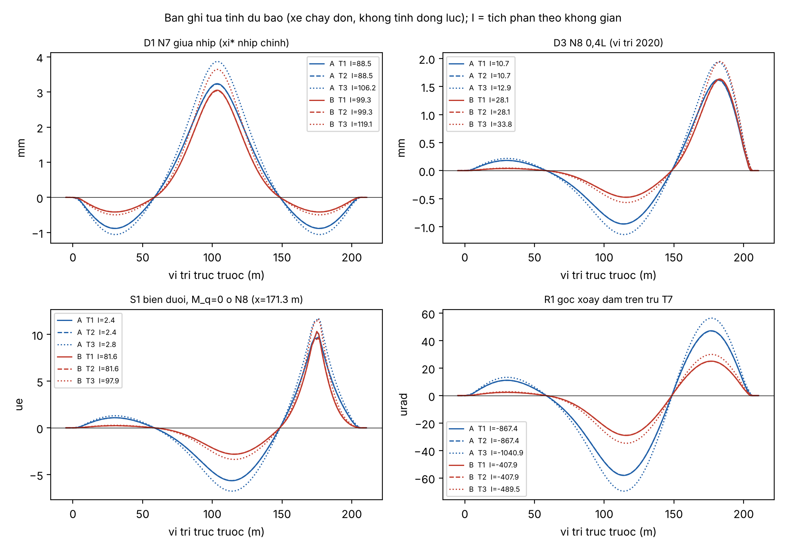
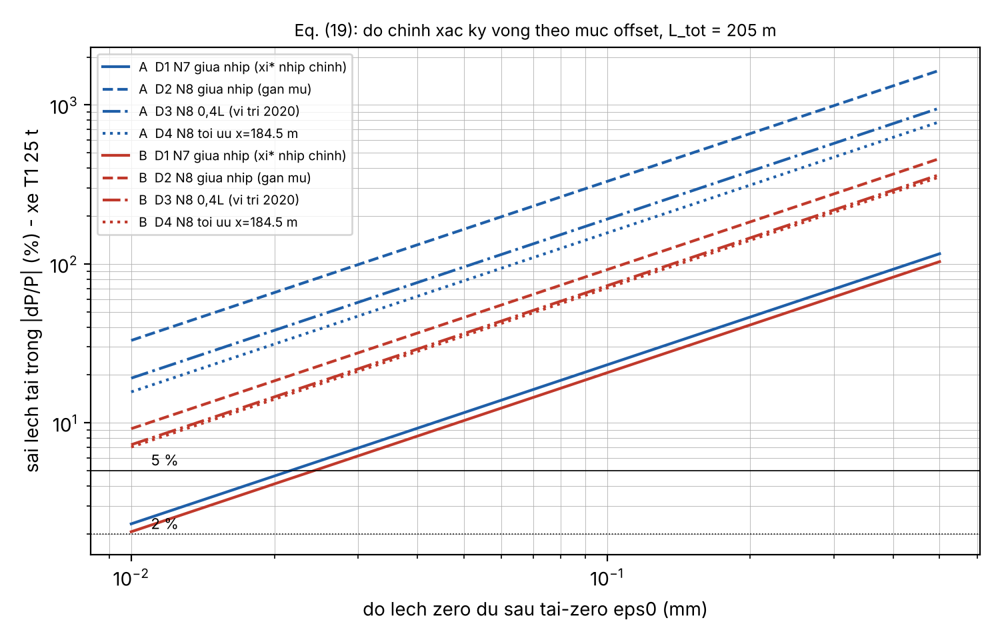
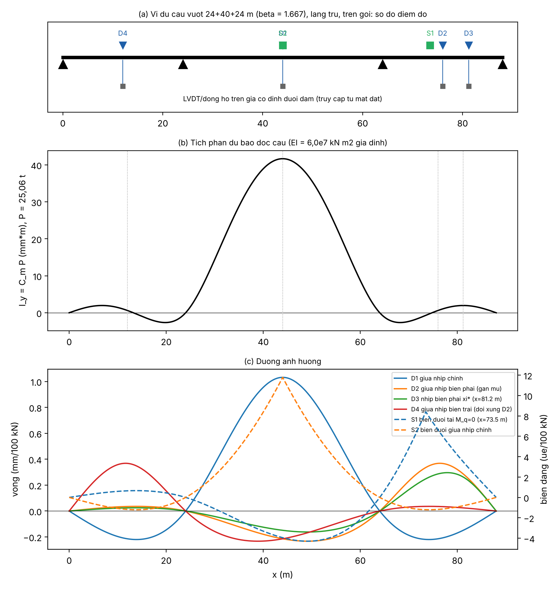

# 0. Tóm tắt cho người quyết định

Bốn biên tập viên đều coi việc **chưa có thử nghiệm tải di động trên kết cấu liên tục** là điểm yếu lớn nhất của bài (docs/editors/00_TONG_HOP_4_BIEN_TAP.md, mục 1). Đề cương này đưa ra hai phương án thử để bù chỗ thiếu đó:

- **Phương án A: thử lại cầu chính Cầu Mây 55 + 90 + 55 m** (dầm hộp vượt sông). Phương án này có giá trị khoa học cao nhất. Một đêm thử với 3 xe đã cân trục cho phép (i) kiểm trực tiếp Eq. (2) trên cầu liên tục thật, (ii) chọn giữa hai hiệu chỉnh A/B mà dữ liệu tĩnh 2020 không phân biệt được, (iii) kiểm vết gần mù tại nhịp biên N8.
- **Phương án B: một cầu vượt đô thị liên tục 2–3 nhịp gần Hà Nội**, tiết diện không đổi, có lối tiếp cận dưới gầm để đặt LVDT. Phương án này rẻ hơn và đo chính xác hơn. Nó kiểm được dạng đóng Eq. (4)/(8) trực tiếp, nhưng không giải quyết câu hỏi về Cầu Mây trong mục 4 của bài.

Các con số dự báo trong đề cương đều do `code/fieldplan/fieldplan_compute.py` tính. Script này gọi `code/analysis/cm_multispan.py` và giữ nguyên file đó, dùng EI vút của Cầu Mây cùng hai hiệu chỉnh trong `code/analysis/logs/wp3_run.log`. Kết quả kiểm lại khớp Bảng 8 của bài: bias khi lệch zero 0,05 mm là 11 % / 10 % tại N7 và 93 % / 35 % tại N8 0,4L. Log nằm ở `code/fieldplan/results/fieldplan_compute.log`.

**Bốn phép đo quyết định ở Cầu Mây** (dự báo của hiệu chỉnh A so với B; xe T1 nặng 25 t):

| Đại lượng đo | Hiệu chỉnh A (EI thiết kế, k_FE = 2,7·10⁷ kN m/rad) | Hiệu chỉnh B (α = 0,716, k = 1,2·10⁸) | Ghi chú |
|---|---|---|---|
| Tỉ số tích phân C(D3)/C(D1): N8 0,4L / N7 giữa nhịp | **0,121** | **0,284** | Không phụ thuộc trọng lượng xe hay EI tuyệt đối |
| Góc xoay đỉnh của dầm trên trụ T7 khi xe T1 qua | **−58 µrad** | **−29 µrad** | Nghiêng kế độ phân giải ≤ 1 µrad là đủ |
| Tích phân biến dạng S1 (điểm M_q = 0 của A, cách T7 26,3 m) / tích phân S2 (giữa N7) | **0,006** (gần mù) | **0,17** | Đo được độ cứng trụ qua vị trí điểm uốn |
| Tỉ số tần số f₂/f₁ ; f₃/f₁ (mô hình, khối lượng giả định) | 1,78 ; 2,30 | 1,59 ; 1,75 | Đo dao động môi trường (ambient) |

---

# 1. Mục tiêu và liên hệ với các luận điểm của bài

| # | Mục tiêu thử | Luận điểm trong bài (manuscript/schm/manuscript.md) | Cách kiểm |
|---|---|---|---|
| O1 | **Bất biến tích phân**: hai xe khác cấu hình trục, cùng tổng trọng lượng (T1 3 trục 25 t, T2 4 trục 25 t), cho cùng I_y/P | Eq. (2); §2.1 | So I_y/P_tot của T1 và T2 tại D1 (và D2–D4, S1, S2, R1). Đỉnh tín hiệu khác nhau nhưng tích phân bằng nhau. Dự báo: đỉnh S2 chênh 4,4 % (16,7 so với 15,9 µε), tích phân chênh 0 % |
| O2 | **Tỉ lệ tuyến tính / khác tổng tải**: T3 (4 trục, khoảng 30 t) và đoàn T1 + T3 | Eq. (2), giả thiết tuyến tính §2.1, §4.4 | Phải có I_y ∝ P_tot. Đoàn xe kiểm phép chồng chất |
| O3 | **SLM với xe chuẩn**: lấy T1 làm chuẩn (trung bình ≥ 5 lượt), nhận dạng T2, T3, đoàn xe | Eq. (11), (18), (20); §7.1 khuyến nghị 5 | Sai số nhận dạng so với phiếu cân |
| O4 | **Vết mù / gần mù của võng kế**: D2 (giữa N8), D3 (N8 0,4L, vị trí 2020), so với D1 và D4 (ξ* nhịp biên) | N_m, R_m (Eq. 13, 14); Bảng 5; §4.3 | Sai số SLM tại D2/D3 lớn hơn D1 đúng theo tỉ lệ 1/C_m của Eq. (19), với ε₀ đo được trong các lượt rỗng |
| O5 | **Vết mù của tensomet** tại điểm M_q = 0 | §2.1, đoạn cuối (strain blind tại điểm uốn mô men của tải đều) | Tích phân biến dạng S1 ≈ 0, trong khi đỉnh S1 vẫn khoảng ±10 µε |
| O6 | **Nhận dạng độ cứng trụ** (tách k khỏi α) | §4.2: "hai số đọc tĩnh không tách được EI và k" | C(D3)/C(D1), góc xoay R1/R2, S1, tần số ambient. Sau đó dự báo mù tích phân D2–D4 và so với số đo |
| O7 | **Hiệu lực động**: tốc độ 5–40 km/h | Eq. (21), Bảng 9; §6.4, §6.5 | Kiểm |I_y(v)/I_y(5 km/h) − 1|. Dự báo T_cr/T₁ = 26 ở 40 km/h (Cầu Mây) và 22 (cầu B), tức ≥ 8, nên E_dyn < 1 % nếu không có tương tác xe–cầu |
| O8 | **Độ lặp**: ≥ 5 lượt cho mỗi tổ hợp xe/tốc độ chính | Eq. (20); §6.3 | Hệ số biến thiên (CV) của I_y |
| O9 | **Quy trình tái-zero baseline** và đo trực tiếp ε₀ | Eq. (16), (19); §5; §7.1 khuyến nghị 8 | Lượt rỗng (cửa sổ tích phân không có xe) và tiêu chí loại bản ghi |
| O10 | **Đo vận tốc / tích phân theo không gian** | §6.4 | GNSS-RTK trên xe cho x(t), tích phân trực tiếp theo x. Đối chứng thêm bằng điểm đổi dấu của đường ảnh hưởng |

Ngoài phạm vi: thử tải tĩnh nghiệm thu, đánh giá khả năng chịu tải và BWIM theo trục.

---

# 2. Cơ sở dự báo (chung cho A và B)

- C_m tại mỗi điểm đo là độ võng dưới tải đều đơn vị (Eq. 3), nên **đường C_m(x) chính là đường đàn hồi dưới tải đều**: Hình A1b và B1b.
- Bản ghi tựa tĩnh y(s) = Σ P_i η(s − a_i) có tích phân I_y = C_m·P_tot. Bias do lệch zero là ε₀·L_tot/(C_m·P), Eq. (19), với L_tot = chiều dài liên tục + chiều dài cơ sở xe.
- Tensomet: hằng số tích phân là c·M_q(x_s)/(EI·q₀), với c là khoảng cách từ trục trung hòa đến thớ dưới (Cầu Mây: 1,572 m ở giữa nhịp, 3,053 m ở mặt trụ, theo LRFR p.5; nội suy theo chiều cao).
- Nghiêng kế trên trụ: đường ảnh hưởng góc xoay lấy theo định lý Maxwell, bằng độ võng dưới mô men đơn vị đặt tại trụ.

**Xe thử (tải trục chia minh họa; giá trị thật lấy theo phiếu cân trục):**

| Xe | Cấu hình | Khoảng cách trục (m) | Tải trục minh họa (t) | Tổng (t) | Vai trò |
|---|---|---|---|---|---|
| T1 | 3 trục (giống xe nghiệm thu 2020) | 3,60 + 1,35 | 5 + 10 + 10 | 25 | Xe chuẩn SLM |
| T2 | 4 trục | 1,80 + 3,00 + 1,35 | 5,5 + 5,5 + 7 + 7 | 25 | Cùng tổng tải, khác trục (O1) |
| T3 | 4 trục (chính xe T2 chất thêm, hoặc một xe khác) | 1,80 + 3,00 + 1,35 | 6 + 6 + 9 + 9 | 30 | Khác tổng tải (O2, O3) |
| T4 (tùy chọn) | 2 trục | 4,50 | 4 + 8 | 12 | Minh họa P_ε với xe nhẹ |

Nếu chỉ có 2 xe thì dùng T1 (25 t) và một xe 4 trục chạy hai lần: lần đầu chất đến khoảng 25 t, sau đó chất thêm đến khoảng 30 t và cân lại. Việc chất thêm tốn khoảng 1 giờ ngoài giờ cấm đường.

---

# 3. Phương án A: thử lại cầu chính Cầu Mây 55 + 90 + 55 m

## 3.1. Dữ liệu đầu vào và giả thiết

- Sơ đồ: T5 và T8 có gối chậu di động; T6 và T7 liền khối với dầm. Dầm cao 2,40 m ở giữa nhịp và 5,40 m ở trụ. I_mid = 5,482 m⁴, I_pier = 59,612 m⁴, Ec = 36 057 MPa. Chiều cao biến đổi theo parabol trên L_v = 44 m, I ∝ h^2,943 (manuscript §4.2; data/bridges/cau-may/INVENTORY.md).
- Hai hiệu chỉnh: A (α = 1, k = 2,748·10⁷ kN m/rad) và B (α = 0,716, k = 1,199·10⁸). Ngoài ra có biến thể A' (α = 1,088 tại k_FE). Nguồn: `code/analysis/logs/wp3_run.log`.
- Khối lượng dùng để tính tần số: 2,55 t/m³ × A(h) cộng tĩnh tải phần trên **3,0 t/m (giả định, [NEED VALUE] lấy từ hồ sơ thiết kế)**. Tần số chỉ dùng để so sánh tương đối giữa A và B.
- Gốc tọa độ x đặt tại tim gối T5. T6 ở x = 55, T7 ở x = 145, T8 ở x = 200 m. Nhịp N6 nằm trong 0–55, N7 trong 55–145, N8 trong 145–200.
- **Cần có trước khi thử** (xem docs/pkg1/3a_yeu_cau_file_tho_Cau_May.md): bản vẽ trụ T6/T7 và móng, mô hình MIDAS cầu chính, file thô SDA-830C. Có các tài liệu này thì chạy lại dự báo và chốt vị trí S1 trước ngày thử.

## 3.2. Vị trí điểm đo chọn theo lý thuyết

Kết quả tính (`A_caumay_sensors.csv`):

- Trên nhịp chính, C_m đạt cực đại tại **x = 100 m (ξ* = 0,5)** với cả A và B, nên đặt D1 ở giữa nhịp N7.
- Trên nhịp biên N8, C_m cực đại tại x = 184,5 m (A; ξ = 0,282 tính từ T8) và x = 182,1 m (B).
- Điểm M_q = 0 trong N8 nằm ở x = 171,4 m với A (cách T7 26,3 m) và x = 168,4 m với B (cách T7 23,3 m).

| Kênh | Loại | x (m) | Lý do chọn | C_m (A / B) | R_m (A / B) | N_m (A / B) |
|---|---|---|---|---|---|---|
| **D1** | Võng, giữa N7 | 100,0 | ξ* của nhịp chính; ổn định với k | 3,61 / 4,05 ·10⁻⁴ m²/kN | 0,59 / 0,77 | 0,209 / 0,234 |
| **D2** | Võng, giữa N8 | 172,5 | **Điểm gần mù** (A: R = 0,11) | 2,53·10⁻⁵ / 9,10·10⁻⁵ | 0,11 / 0,49 | 0,105 / 0,377 |
| **D3** | Võng, N8 0,4L | 178,0 | Đúng vị trí võng kế 2020; nhạy với k | 4,38·10⁻⁵ / 1,15·10⁻⁴ | 0,18 / 0,56 | 0,181 / 0,476 |
| **D4** | Võng, ξ* nhịp biên | 184,5 | Tối ưu trên nhịp biên (Bảng 2 cho dầm vút) | 5,34·10⁻⁵ / 1,19·10⁻⁴ | 0,25 / 0,61 | 0,221 / 0,492 |
| D5 (tùy chọn) | Võng, N6 0,4L | 22,0 | Đối xứng với D3: kiểm đối xứng và độ cứng hai trụ | như D3 | như D3 | như D3 |
| **S1** | Tensomet thớ dưới (sàn đáy hộp, 2 sườn) | 171,3 (chốt lại theo mô hình MIDAS) | **Điểm uốn mô men của tải đều**: mù theo tích phân biến dạng | 9,6·10⁻⁹ / 3,3·10⁻⁷ (m/kN) | 0,01 / 0,38 | – |
| **S2** | Tensomet thớ dưới, giữa N7 | 100,0 | Kênh biến dạng tham chiếu, điều kiện tốt | 1,55·10⁻⁶ / 1,95·10⁻⁶ | 0,73 / 0,88 | – |
| **R1** | Nghiêng kế trên dầm, tim trụ T7 (vách ngăn) | 145,0 | Nhận dạng k (O6) | – | – | – |
| R2 | Nghiêng kế trên dầm, tim trụ T6 | 55,0 | Như R1, cho trụ còn lại | – | – | – |
| R3 (tùy chọn) | Nghiêng kế trên thân trụ T7, sát đáy dầm | – | Tách xoay thân trụ khỏi xoay móng | – | – | – |
| A1–A5 | Gia tốc kế đứng: giữa N6, N7, 1/4 N7, giữa N8; dọc cầu trên đỉnh T7 | – | Tần số và dạng dao động riêng (O6), đánh giá động | – | – | – |

Hình A1 (`code/fieldplan/figures/fA1_caumay_layout_IL.png`) gồm: (a) sơ đồ bố trí; (b) tích phân dự báo I_y = C_m(x)·P dọc cầu; (c) đường ảnh hưởng võng tại D1–D4; (d) đường ảnh hưởng biến dạng S1, S2 và góc xoay R1.

{width=100%}

**Bố trí chi tiết (mô tả thay bản vẽ):**

- Võng D1–D5: mỗi tiết diện có một điểm trên tim hộp (đáy hộp, bên trong) cho hệ HLS. Cũng tại tiết diện đó đặt thêm hai tiêu (gương hoặc target) trên lan can hai bên cho hệ đối chứng không tiếp xúc, giống "3 điểm/tiết diện" của năm 2020 để lấy trung bình ngang. Đo vị trí thực bằng thước thép/toàn đạc, sai số ±2 cm.
- Tensomet S1, S2: mỗi tiết diện gắn 2 cảm biến trên sàn đáy hộp, sát chân hai sườn, mặt trong. Thêm 1 cảm biến bù nhiệt dán trên mẫu bê tông không chịu lực.
- Nghiêng kế R1, R2: gắn trên sàn đáy hộp tại tim vách ngăn trụ, trục đo theo phương dọc cầu.
- Nhiệt độ: 4 cặp nhiệt (sàn trên, sàn đáy, trong hộp ở N7 và N8) và 1 cảm biến nhiệt không khí ngoài hộp.
- Phát hiện trục và vị trí xe: GNSS-RTK trên nóc cabin từng xe (10–20 Hz). Thêm công tắc băng (tape switch) hoặc cổng quang tại khe co giãn T5, tại x = 100 m và tại khe T8. Camera hành trình ghi vị trí ngang.

## 3.3. Đo độ võng trên mặt nước: chọn phương pháp

Độ võng cần đo là đỉnh 1,4–3,9 mm và tích phân 6–120 mm·m. Muốn bias Eq. (19) ≤ 5 % tại D1 thì ε₀ ≤ 0,02 mm. Mặt cầu cao trên sông nên không thể dùng giá cố định dưới đáy dầm.

| Phương pháp | Độ chính xác khả thi (điển hình, **phải kiểm bằng lượt rỗng tại hiện trường**) | Ổn định baseline trong cửa sổ 3–5 phút | Đánh giá |
|---|---|---|---|
| **Hệ thủy chuẩn thủy tĩnh (HLS, cảm biến áp lực/mực chất lỏng) đặt trong hộp**, điểm chuẩn trên vách trụ T7 (và T6) | Độ phân giải 0,01–0,05 mm theo catalog thông dụng [NEED VALUE: catalog thiết bị cụ thể]. Đáp ứng chậm, cỡ vài giây | Tốt: trong hộp kín, ít chịu nắng và gió, thử ban đêm | **Chính, cho lượt crawl** (5–10 km/h). Đo được D1–D5 đồng thời so với điểm chuẩn trên trụ. Lún đàn hồi của đỉnh trụ liền khối do một xe 25 t cỡ ≤ 0,01 mm (ước lượng, kiểm bằng R3) |
| **Radar giao thoa mặt đất (GB-InSAR / interferometric radar)** đặt trên bờ hoặc dưới gầm, nhìn xiên lên | Cỡ 0,01–0,1 mm theo phương nhìn; 50–200 Hz; nhiều điểm cùng lúc | Khá: ảnh hưởng khí quyển trong vài phút nhỏ, phải trừ bằng điểm chuẩn tĩnh (trụ) | **Chính, cho lượt nhanh** và đối chứng độc lập D1–D4. Phải đổi phương nhìn sang phương đứng (cần hình học chính xác) |
| Camera (vision) với tiêu LED, đặt trên mốc bê tông ở bờ | 0,1–0,5 mm ở khoảng cách khoảng 100–200 m với ống kính tele và tiêu chủ động; kém hơn khi có khí nóng bốc lên hoặc rung chân máy | Trung bình: nhạy với chuyển động chân máy và nhiệt. Ban đêm dùng LED thì ổn định hơn | Đối chứng phụ, kiểm dạng đường ảnh hưởng và đỉnh. Không dùng làm kênh tích phân chính tại D2/D3 |
| Toàn đạc robot (0,5″, bám gương 10–20 Hz) | Sai số góc 0,5″ ứng với khoảng 0,24 mm tại 100 m và 0,36 mm tại 150 m (1σ); khi động thì kém hơn | Trung bình: khúc xạ trên mặt nước | Đối chứng đỉnh tĩnh cho lượt đỗ xe; không đủ cho tích phân D2/D3 |
| GNSS-RTK trên dầm | Cao độ khoảng 10–20 mm | Kém | **Không đạt** (tín hiệu chỉ 1,4–3,9 mm). Chỉ dùng GNSS cho vị trí xe |
| Laser Doppler vibrometer | Đo vận tốc, nên phải tích phân ra chuyển vị và bị trôi ở tần thấp | Không có thành phần tĩnh | Không dùng cho tích phân crawl; dùng cho dạng dao động nếu có sẵn |
| Tái dựng độ võng từ nghiêng kế (5–9 nghiêng kế/nhịp, tích phân góc xoay) | Phụ thuộc số điểm và nhiễu; sai số tích lũy dọc 90 m | Tốt, nếu nghiêng kế ổn định nhiệt | Đối chứng thứ ba, có thêm góc xoay trụ. Chỉ nên làm nếu có sẵn nhiều nghiêng kế |

**Khuyến nghị cho A:**

- Kênh tích phân chính: HLS trong hộp.
- Đối chứng độc lập: radar giao thoa (nếu thuê được) hoặc camera + LED từ bờ.
- Đỉnh tĩnh của lượt đỗ xe: toàn đạc robot.
- Bias của từng hệ được xác định bằng 5 lượt rỗng (mục 3.7). Các con số độ chính xác ở bảng trên là giá trị điển hình từ catalog và tài liệu, chưa phải giá trị đã kiểm cho Cầu Mây.

[NEED VALUE: khoảng cách từ bờ đến giữa nhịp N7 và đến D2–D4; cao độ mặt nước và tĩnh không thông thuyền; vị trí đặt máy trên bờ.]

## 3.4. Danh mục thiết bị

| Nhóm | Số lượng | Kiểu/loại (ví dụ cấp thiết bị) | Yêu cầu độ chính xác | Tần số lấy mẫu |
|---|---|---|---|---|
| HLS (thủy tĩnh áp lực) | 6–8 cảm biến (D1–D5 + 2 điểm chuẩn trên trụ) + bình chuẩn | Hệ HLS áp lực vi sai, ống dẫn chất lỏng dọc hộp | Độ phân giải ≤ 0,02 mm; trôi ≤ 0,01 mm/5 phút [NEED VALUE: catalog] | ≥ 10 Hz (ghi 100 Hz) |
| Radar giao thoa | 1 bộ | GB-InSAR thương mại (thuê) | ≤ 0,05 mm theo phương nhìn | 100 Hz |
| Camera + tiêu LED | 1–2 camera, 6–8 tiêu | Camera công nghiệp ≥ 5 MP, ống kính 300–600 mm, chân máy nặng trên mốc | ≤ 0,3 mm | 50 fps |
| Toàn đạc robot | 1 | Cấp 0,5″, có chế độ bám | – | 10–20 Hz |
| Tensomet | 6 (S1 ×2, S2 ×2, bù nhiệt ×2) | Cảm biến biến dạng gauge dài trên bê tông (cầu điện trở toàn cầu hoặc FBG), gauge ≥ 100 mm | Độ phân giải ≤ 0,2 µε (tín hiệu đỉnh 10–20 µε) | 100 Hz |
| Nghiêng kế | 2–3 | Nghiêng kế độ phân giải cao (điện phân/servo), 1 trục dọc cầu | Độ phân giải ≤ 1 µrad (tín hiệu 29–58 µrad) | 50–100 Hz |
| Gia tốc kế | 5 | Gia tốc kế địa chấn/MEMS nhiễu thấp. Có thể dùng SDA-830C sẵn có nếu xuất được file thô | Nhiễu ≤ 1 µg/√Hz ở 1 Hz | 200 Hz |
| Bộ ghi dữ liệu | 2–3 | 24-bit, đồng bộ GPS-PPS | Sai lệch thời gian ≤ 1 ms giữa các bộ | – |
| GNSS-RTK trên xe | 3 + trạm base | Đầu thu RTK 10–20 Hz | Vị trí ngang ≤ 3 cm | 10–20 Hz |
| Công tắc băng / cổng quang | 3 vị trí | – | – | 1 kHz |
| Cặp nhiệt | 5 | – | ±0,1 °C | 1 Hz |
| Máy đo gió | 1 | – | – | 1 Hz |

## 3.5. Dự báo tín hiệu cho các xe đã chọn

Bảng dưới đây là bản ghi tựa tĩnh, chỉ tính một xe chạy dọc tim cầu (`A_caumay_sensors.csv`). "Đỉnh" là cực trị của bản ghi; [min, max] cho thấy thùy âm khi xe ở nhịp lân cận.

| Kênh | Hiệu chỉnh | T1 25 t: đỉnh [min, max] | T1: I | T2 25 t: đỉnh | T2: I | T3 30 t: đỉnh | T3: I |
|---|---|---|---|---|---|---|---|
| D1 (mm; mm·m) | A | 3,24 [−0,88; 3,24] | 88,5 | 3,22 | 88,5 | 3,87 | 106,2 |
| | B | 3,05 [−0,42; 3,05] | 99,3 | 3,03 | 99,3 | 3,64 | 119,1 |
| D2 | A | 1,50 [−0,99; 1,50] | **6,2** | 1,49 | 6,2 | 1,79 | 7,5 |
| | B | 1,42 [−0,49; 1,42] | 22,3 | 1,41 | 22,3 | 1,70 | 26,8 |
| D3 | A | 1,62 [−0,95; 1,62] | **10,7** | 1,61 | 10,7 | 1,94 | 12,9 |
| | B | 1,63 [−0,47; 1,63] | 28,1 | 1,62 | 28,1 | 1,95 | 33,8 |
| D4 | A | 1,48 [−0,78; 1,48] | 13,1 | 1,47 | 13,1 | 1,77 | 15,7 |
| | B | 1,57 [−0,39; 1,57] | 29,1 | 1,56 | 29,1 | 1,87 | 34,9 |
| S1 (µε; µε·m) | A | +10,2 [−5,7; +10,2] | **2,4** | +9,7 | 2,4 | +11,8 | 2,8 |
| | B | +10,3 [−2,8; +10,3] | 81,6 | +9,6 | 81,6 | +11,7 | 97,9 |
| S2 | A | +16,7 [−2,0; +16,7] | 381 | +15,9 | 381 | +19,3 | 458 |
| | B | +20,0 [−0,9; +20,0] | 478 | +19,0 | 478 | +23,0 | 574 |
| R1 (µrad) | A | −58,1 [−58,1; +47,2] | – | −58,0 | – | −69,6 | – |
| | B | −29,0 [−29,0; +25,1] | – | −28,9 | – | −34,7 | – |

Cách đọc bảng:

1. **Đỉnh ở D2/D3 gần như như nhau giữa A và B (khoảng 1,5–1,6 mm), nhưng tích phân chênh 2,6–3,6 lần.** Số đọc đỉnh (như năm 2020) vì vậy không phân biệt được A và B; tích phân của lượt crawl phân biệt được.
2. T1 và T2 cho tích phân giống hệt nhau, trong khi đỉnh biến dạng S2 chênh 4,4 %. Đây là minh họa trực tiếp cho O1.
3. Thùy âm của D2/D3 khi xe ở N7 (−0,5 đến −1,0 mm) đo được bằng HLS và là bằng chứng của sự triệt tiêu.

{width=100%}

**Độ nhạy theo độ cứng trụ** (`A_caumay_k_sweep.csv`, EI thiết kế):

| k (kN m/rad) | 1·10⁷ | 2,75·10⁷ (A) | 5·10⁷ | 1,2·10⁸ | 3·10⁸ | 1·10⁹ |
|---|---|---|---|---|---|---|
| C(D3)/C(D1) | 0,063 | 0,121 | 0,172 | 0,255 | 0,325 | 0,374 |
| Góc xoay đỉnh T7, xe T1 (µrad) | −75,7 | −58,1 | −44,9 | −26,5 | −13,0 | −4,4 |
| f₁ (Hz, khối lượng giả định) | 1,27 | 1,41 | 1,55 | 1,82 | 2,10 | 2,33 |

Tần số đo năm 2020 (3,43–3,64 Hz, xe kích thích, "thẳng đứng giữa nhịp") không khớp f₁ = 1,4–1,6 Hz của mô hình mà gần với mode 3 hoặc mode 4. Vì vậy cần đo ambient đủ dài để tách các mode 1–4. Không nên dùng con số 2020 làm f₁.

## 3.6. Độ chính xác kỳ vọng theo mức lệch zero

Bias của tải nhận dạng theo Eq. (19), xe T1 25 t, L_tot = 205 m (`A_caumay_offset_bias.csv`; Hình A3). Với T3 30 t nhân với 25/30; với đoàn T1 + T3 (55 t) nhân với 25/55.

| Kênh | Hiệu chỉnh | ε₀ = 0,01 mm | 0,02 | 0,05 | 0,10 | 0,20 | 0,50 |
|---|---|---|---|---|---|---|---|
| D1 | A | 2,3 % | 4,6 % | 11,6 % | 23 % | 46 % | 116 % |
| D1 | B | 2,1 % | 4,1 % | 10,3 % | 21 % | 41 % | 103 % |
| D2 | A | 33 % | 66 % | 165 % | 330 % | 660 % | 1650 % |
| D2 | B | 9,2 % | 18 % | 46 % | 92 % | 184 % | 459 % |
| D3 | A | 19 % | 38 % | 96 % | 191 % | 382 % | 955 % |
| D3 | B | 7,3 % | 15 % | 36 % | 73 % | 146 % | 364 % |
| D4 | A | 16 % | 31 % | 78 % | 157 % | 313 % | 782 % |
| D4 | B | 7,0 % | 14 % | 35 % | 70 % | 141 % | 352 % |

{width=80%}

Hệ quả cho thiết kế thử:

1. Muốn kiểm O1–O3 tại D1 với sai số ≤ 3–5 % thì cần ε₀ ≤ 0,01–0,02 mm cho mỗi lượt, rồi lấy trung bình ≥ 5 lượt. Nếu ε₀ của các lượt độc lập nhau thì thành phần ngẫu nhiên giảm theo √N.
2. Tại D2/D3, ngay cả ε₀ = 0,01 mm đã cho 19–33 % với hiệu chỉnh A. **Đây chính là điều cần chứng minh (O4)**: tại D2/D3, phân tán của tải nhận dạng phải lớn hơn tại D1 theo tỉ lệ C(D1)/C(D2) ≈ 14 (A) hoặc 4,4 (B).
3. Tỉ số C(D3)/C(D1) dùng tổng hợp mọi lượt và mọi xe, nên sai số chuẩn ước khoảng ±0,01–0,02 khi ε₀ = 0,02 mm và có khoảng 20 lượt crawl. Mức này nhỏ hơn nhiều so với hiệu A − B = 0,16, nên phép phân biệt là quyết định.

## 3.7. Quy trình tái-zero baseline (cho mọi kênh)

1. **Cửa sổ yên tĩnh trước lượt**: 60 s, xe chờ trên cầu dẫn cách khe T5 (hoặc T8) ≥ 40 m. Cầu dẫn giản đơn sau khe co giãn nên không truyền tải vào cầu chính. Không có phương tiện nào khác trên toàn cầu; máy nổ của xe vẫn chạy để giữ điều kiện giống nhau.
2. **Lượt chạy**: GNSS ghi x(t). Cửa sổ tích phân bắt đầu khi trục trước vào khe T5 và kết thúc khi trục sau ra khỏi khe T8 (§2.1: không được cắt sớm).
3. **Cửa sổ yên tĩnh sau lượt**: 60 s, kể từ khi xe cách khe T8 ≥ 40 m.
4. **Baseline**: tuyến tính giữa trung bình 20 s cuối của cửa sổ trước và 20 s đầu của cửa sổ sau. Lọc thông thấp pha-không ở ≤ f₁/3 (khoảng 0,4 Hz với Cầu Mây). **Không dùng lọc thông cao** (§5, §7.1).
5. **Tiêu chí nhận bản ghi**: |y_sau − y_trước| ≤ 0,05 mm tại D1 với HLS (ngưỡng chốt lại sau thử ổn định); độ lệch chuẩn trong cửa sổ yên tĩnh ≤ 0,02 mm; không có xe lạ. Bản ghi không đạt thì đánh dấu "loại" nhưng vẫn lưu.
6. **Lượt rỗng (null run)**: chạy đúng quy trình 1–4 nhưng không có xe, cửa sổ tích phân dài bằng một lượt crawl (150 s). Ước lượng trực tiếp ε₀ = I_null/L_tot. Làm 5 lượt rỗng rải đều trong đêm, để Eq. (19) dùng ε₀ **đo được** thay cho giá trị giả định.
7. **Thử ổn định**: 30 phút cầu rỗng ở đầu đêm để đo tốc độ trôi của từng kênh theo nhiệt độ.

## 3.8. Ma trận lượt chạy (một đêm cấm đường, có thứ tự ưu tiên)

Quy ước: C = đi theo tim cầu (xe chạy đè vạch tim; cấm đường nên làm được), E = làn phải lệch tâm (bánh ngoài cách bó vỉa 0,6 m như năm 2020). Chiều chạy luân phiên Bắc → Nam và Nam → Bắc, để lượt quay về cũng là một lượt đo.

| Mã | Nội dung | Xe | Tốc độ | Vị trí ngang | Số lượt | Ưu tiên | Thời gian ước tính |
|---|---|---|---|---|---|---|---|
| Z0 | Thử ổn định cầu rỗng | – | – | – | 1 × 30 phút | 1 | 30 phút |
| AMB | Dao động môi trường (trước khi cấm, còn xe thường) và 20 phút cầu rỗng | – | – | – | 60 + 20 phút | 1 | (trước giờ cấm) + 20 phút |
| ST | Đỗ xe T1 tại x = 100; 178; 184,5; 22; 145 m, mỗi vị trí 3 phút, có số đọc zero xen kẽ | T1 | 0 | C | 5 vị trí | 2 | 40 phút |
| N | Lượt rỗng | – | – | – | 5 | 1 | 5 × 5 phút |
| C1 | Crawl | T1 | 5 km/h | C | 6 (3 mỗi chiều) | 1 | 6 × 7 phút |
| C2 | Crawl | T2 (25 t) | 5 km/h | C | 6 | 1 | 42 phút |
| C3 | Crawl | T3 (30 t) | 5 km/h | C | 6 | 1 | 42 phút |
| CV | Đoàn T1 + T3, khoảng cách cố định 15 m (giữ bằng bộ đàm + GNSS) | T1 + T3 | 5 km/h | C | 3 | 2 | 21 phút |
| CE | Crawl lệch tâm | T1 | 5 km/h | E | 3 | 2 | 21 phút |
| V1 | Quét tốc độ | T1 | 10; 20; 30; 40 km/h | C | 3 mỗi tốc độ = 12 | 1 | 12 × 4 phút |
| V2 | Quét tốc độ | T2 | 20; 40 km/h | C | 3 mỗi tốc độ = 6 | 2 | 24 phút |
| T4 | (tùy chọn) Crawl xe nhẹ | T4 | 5 km/h | C | 3 | 3 | 21 phút |

Tổng ưu tiên 1: khoảng 4,4 giờ. Ưu tiên 1 + 2: khoảng 6,0 giờ. Một đêm cấm 22:00–05:00 (7 giờ, trừ 30 phút triển khai và 30 phút giải tỏa) chạy hết ưu tiên 1 và phần lớn ưu tiên 2. Nếu kém thời tiết hoặc trễ, dùng đêm dự phòng.

Về tốc độ: các nhánh cầu dẫn dài khoảng 198 m (phía 39,15 + 3×40 + 39,15) và khoảng 278 m (phía 39,15 + 5×40 + 39,15), đủ để tăng tốc lên 40 km/h trước khe co giãn. T_cr/T₁ (A, f₁ = 1,41 Hz) lần lượt là 209; 104; 52; 35; 26 ở 5; 10; 20; 30; 40 km/h, đều ≥ 8. Bước không gian khi ghi 100 Hz là 1,4–11 cm, nhỏ hơn nhiều so với l/20.

## 3.9. Yêu cầu xe và cân

- Xe chở tải không đổi trong suốt đêm: khối thép hoặc bê tông, hoặc cát khô phủ bạt và chằng chống xê dịch. Đổ đầy nhiên liệu trước khi cân.
- **Cân từng trục và tổng** tại trạm cân có kiểm định, trước và sau đêm thử. Lưu phiếu cân (ảnh chụp + bản gốc) ghi biển số, giờ cân, tải từng trục hoặc từng cụm trục, và cấp chính xác của cân [NEED VALUE]. Chênh lệch trước/sau > 0,5 % thì dùng trung bình và ghi vào ngân sách sai số (δP₀ trong Eq. 18).
- Đo khoảng cách trục và vệt bánh bằng thước thép (±1 cm); ghi loại lốp và áp suất lốp.
- Tài xế có kinh nghiệm giữ tốc độ thấp ổn định (số thấp, không phanh trên cầu chính). Có bộ đàm và người dẫn đường.

## 3.10. Cấm đường, giấy phép và an toàn

- **Cấm hoàn toàn** cầu Mây (684,75 m, gồm cả cầu dẫn) trong khung giờ đêm và phân luồng ĐT389. Cần giấy phép thi công trên đường đang khai thác của cơ quan quản lý đường địa phương [NEED VALUE: xác nhận cơ quan quản lý ĐT389 sau sắp xếp đơn vị hành chính 2025], phối hợp CSGT, và văn bản đồng ý của chủ quản lý công trình.
- Nếu đặt radar/camera dưới gầm hoặc dùng thuyền: thông báo cảng vụ đường thủy nội địa; thuyền có phao cứu sinh.
- Làm việc trong hộp kín: đo khí trước khi vào, thông gió, chiếu sáng, liên lạc (sóng radio yếu trong hộp nên cần dây hoặc repeater), tối thiểu 2 người. Lắp tiêu trên lan can phải có dây an toàn.
- Ban đêm: biển báo, đèn, nón tín hiệu, áo phản quang; một chỉ huy an toàn riêng, không kiêm đo.
- Điều kiện dừng thử: mưa (làm thay đổi tải cát), gió > [NEED VALUE] m/s, sự cố giao thông.

## 3.11. Nhân lực

| Vai trò | Số người |
|---|---|
| Chủ nhiệm thử nghiệm (quyết định nhận/loại lượt) | 1 |
| Kỹ sư đo kênh tiếp xúc (HLS, tensomet, nghiêng kế; trong hộp) | 2–3 |
| Kỹ sư trắc địa / radar / camera (trên bờ) | 2 |
| Kỹ sư dao động (ambient, gia tốc) | 1 |
| Điều phối xe + ghi nhật ký lượt chạy | 1 |
| Tài xế | 3 (+1 dự phòng) |
| An toàn và phân luồng (cùng CSGT) | 2–4 |
| Thuyền (nếu cần) | 1–2 |

## 3.12. Lịch trình (1–2 ngày)

| Thời gian | Việc |
|---|---|
| Trước ngày thử ≥ 2 tuần | Nhận hồ sơ (3a); chạy lại dự báo với mô hình MIDAS và kích thước trụ; chốt vị trí S1; xin phép; thuê thiết bị |
| Ngày 0, 07:00–17:00 (không cấm đường) | Lắp HLS, tensomet, nghiêng kế, cáp trong hộp; dựng mốc và máy trên bờ; khảo sát vị trí cảm biến; chất tải và cân xe |
| Ngày 0, 19:00–22:00 | Đo ambient khi còn giao thông; kiểm tra toàn hệ, đồng bộ thời gian |
| Đêm 0, 22:00–05:00 (cấm đường) | Z0, N, ST, C1–C3, V1, rồi CV, CE, V2 (theo ưu tiên) |
| Ngày 1, sáng | Cân lại xe; sao lưu 2 bản dữ liệu; kiểm nhanh tiêu chí; tháo thiết bị (hoặc giữ lại cho đêm dự phòng) |
| Đêm 1 (dự phòng) | Bổ sung lượt bị loại hoặc ưu tiên 2–3 |

## 3.13. Tiêu chí nghiệm thu (A)

| # | Tiêu chí | Ngưỡng |
|---|---|---|
| K1 | Lượt rỗng: ε₀ (trung bình ± độ lệch chuẩn) tại D1 | ≤ 0,02 mm. Nếu lớn hơn, chỉ báo cáo O1–O3 dưới dạng có điều kiện |
| K2 | Độ lặp: CV của I_y tại D1 trong 6 lượt crawl cùng xe | ≤ 2 % |
| K3 | Bất biến (O1): |(Ī/P)_T2 / (Ī/P)_T1 − 1| tại D1 | ≤ max(3 %, 2u), với u là độ không đảm bảo chuẩn kết hợp |
| K4 | Tuyến tính (O2): (Ī/P) của T3 và của đoàn xe so với T1 tại D1 | ≤ max(3 %, 2u) |
| K5 | SLM (O3): sai số nhận dạng T2, T3, đoàn xe tại D1 (chuẩn = trung bình 6 lượt T1) | ≤ 5 % |
| K6 | Vết gần mù (O4): tỉ số độ lệch chuẩn tải nhận dạng σ_P(D2)/σ_P(D1) | Phù hợp C(D1)/C(D2) của mô hình đã nhận dạng trong khoảng ±30 % |
| K7 | Tensomet mù (O5): |I_S1|/I_S2 | ≤ 0,05 nếu điểm uốn đúng như mô hình; nếu không, vị trí đo được của điểm uốn được dùng để nhận dạng k |
| K8 | Nhận dạng k (O6): C(D3)/C(D1), R1, S1 và f₂/f₁ cùng chỉ về một khoảng k/α | Độ không đảm bảo mở rộng (k = 2) của C(D3)/C(D1) ≤ 0,05 |
| K9 | Dự báo mù: sau khi nhận dạng k, α từ D1 + R1 + ambient, so I_y dự báo với đo tại D2–D4 | Lệch ≤ 2u |
| K10 | Động (O7): |I_y(v)/I_y(5 km/h) − 1| tại D1 với mọi v ≤ 40 km/h | ≤ 3 %. Nếu vượt, báo cáo như giới hạn do tương tác xe–cầu (Eq. 21 là điều kiện cần) |
| K11 | Vận tốc: tích phân theo x (GNSS) so với tích phân theo t nhân v trung bình | Ghi nhận chênh lệch; không phải tiêu chí loại |

## 3.14. Xử lý dữ liệu (tóm tắt, theo §7.1)

1. Đồng bộ mọi kênh theo GPS-PPS.
2. Tái-zero theo mục 3.7.
3. Lọc thông thấp pha-không ở ≤ f₁/3.
4. Chuyển trục thời gian sang trục không gian x(t) của trục trước, lấy từ GNSS.
5. Tích phân hình thang với Δx ≤ l/20.
6. Tính I/P, SLM theo Eq. (11), và độ không đảm bảo theo GUM với tương quan offset trong SLM (sửa luôn điểm BT4 nêu về Bảng 10).

---

# 4. Phương án B: cầu vượt/cầu đô thị liên tục 2–3 nhịp gần Hà Nội

## 4.1. Tiêu chí chọn cầu

1. **Thực sự liên tục**: dầm liên tục, không phải dầm giản đơn có bản liên tục nhiệt. Thẳng, chéo ≤ 15°, không cong.
2. **Tỉ lệ nhịp** (để có vết gần mù chứng minh được, theo Eq. (8) và Eq. (6)):
   - 3 nhịp đối xứng: chọn β ∈ [1,55; 1,80]. Khi đó N_m giữa nhịp biên ≤ 0,3 và ξ* cải thiện rõ.
   - 2 nhịp: chọn ρ_L ∈ [1,30; 1,55], điểm đo giữa nhịp ngắn.
   - Nếu chỉ có cầu β ≈ 1–1,4: vẫn làm được O1–O3 và O7–O9; vết mù khi đó chứng minh bằng tensomet tại điểm M_q = 0 (luôn tồn tại).

   | β (3 nhịp, EI đều) | N_m giữa nhịp biên | ξ* | N_m tại ξ* | N_m giữa nhịp chính |
   |---|---|---|---|---|
   | 1,0 | 1,300 | 0,446 | 1,322 | 0,100 |
   | 1,2 | 1,039 | 0,425 | 1,076 | 0,470 |
   | 1,4 | 0,688 | 0,388 | 0,758 | 0,651 |
   | 1,5 | 0,481 | 0,358 | 0,581 | 0,705 |
   | 1,6 | 0,252 | 0,318 | 0,398 | 0,744 |
   | 1,7 | 0,002 | 0,261 | 0,220 | 0,771 |
   | 1,8 | −0,270 | 0,174 | 0,069 | 0,790 |

   Hai nhịp, điểm đo giữa nhịp được đo, EI đều: N_m = 0,750; 0,390; 0,165; −0,090; −0,250 tại ρ_L = 1,0; 1,2; 1,3; 1,4; 1,457 (`B_selection_beta.csv`).
3. **Tiết diện không đổi** (lăng trụ) để kiểm trực tiếp dạng đóng. Nếu có vút thì phải có bản vẽ đầy đủ.
4. **Gối cầu trên mọi trụ** (cao su hoặc chậu) để điều kiện biên rõ ràng. Trụ liền khối thì phải thêm nghiêng kế như ở A.
5. **Nhịp chính 20–40 m**, sao cho đỉnh võng tại D1 ≥ 2 mm dưới xe 25 t.
6. **Tiếp cận dưới gầm**: tĩnh không ≤ 6–8 m; nền khô và phẳng dưới D1–D4 và S1; không phải đường đang khai thác (hoặc đường đó cấm được cùng lúc).
7. **Lưu lượng thấp**: cấm được ≥ 4 giờ ban đêm. Cầu dẫn hoặc đường dẫn ≥ 100 m mỗi đầu để đạt 40 km/h.
8. Tình trạng tốt: mặt đường và khe co giãn êm (giảm tương tác xe–cầu), gối làm việc bình thường. Có hồ sơ thiết kế/hoàn công (EI) và kết quả thử tải nếu có.
9. Trong bán kính khoảng 50 km quanh Hà Nội; chủ quản lý đồng ý.

[NEED VALUE: danh sách 2–3 cầu ứng viên. Đề nghị hỏi Công ty Tư vấn ĐHXD về các cầu vượt liên tục đã kiểm định gần đây và có hồ sơ.]

## 4.2. Ví dụ tính: 24 + 40 + 24 m (β = 1,667), lăng trụ, trên gối

EI = 6,0·10⁷ kN m² và m = 18 t/m là **giả định minh họa**. Thay bằng giá trị thiết kế khi đã chọn cầu: tín hiệu tỉ lệ với 1/EI, còn R_m, tỉ số giữa các kênh và vị trí điểm mù không đổi.

Kết quả: Eq. (8) cho N_m giữa nhịp biên = 0,087 (gần mù), ξ* = 0,282 cho N_m = 0,278. Điểm M_q = 0 trong nhịp biên cách trụ 9,5 m. f₁ = 2,64 Hz (giả định). T_cr/T₁ = 22 ở 40 km/h và 180 ở 5 km/h.

| Kênh | x (m) | C_m | R_m | N_m | T1: đỉnh / I | T3: đỉnh / I | Bias T1 khi ε₀ = 0,01 / 0,02 / 0,05 mm |
|---|---|---|---|---|---|---|---|
| D1 giữa nhịp chính | 44,0 | 1,70·10⁻⁴ m²/kN | 0,71 | 0,763 | 2,49 mm / 41,6 mm·m | 2,95 / 49,9 | 2,2 / 4,5 / 11,2 % |
| D2 giữa nhịp biên phải (gần mù) | 76,0 | 2,5·10⁻⁶ | 0,04 | 0,087 | 0,87 / 0,62 | 1,02 / 0,74 | 151 / 302 / 754 % |
| D3 ξ* nhịp biên phải | 81,2 | 8,0·10⁻⁶ | 0,17 | 0,278 | 0,70 / 1,96 | 0,82 / 2,35 | 47 / 95 / 237 % |
| D4 giữa nhịp biên trái (đối xứng D2) | 12,0 | như D2 | | | | | |
| S1 thớ dưới tại M_q = 0 | 73,5 | ≈ 0 (−2·10⁻⁸ m/kN) | −0,02 | – | 18,0 µε / −4,9 µε·m | 20,3 / −5,9 | – |
| S2 thớ dưới giữa nhịp chính | 44,0 | 1,54·10⁻⁶ | 0,80 | – | 26,2 µε / 379 µε·m | 29,7 / 454 | – |

(c = 1,1 m cho tensomet là giả định.) Với β = 1,667 thì nhịp biên kém đến mức ngay cả LVDT ε₀ = 0,01 mm cũng cho bias 47–151 %. Cầu B vì vậy là phép minh họa rất rõ cho O4 và O5. O1–O3 kiểm tại D1.

{width=95%}

## 4.3. Thiết bị và bố trí (B)

- **Võng (tham chiếu tiếp xúc)**: LVDT (hành trình ±25 mm, độ tuyến tính ≤ 0,1 % FS, ghi 24-bit) hoặc đồng hồ điện tử có cổng dữ liệu (độ phân giải 0,001 mm). Cảm biến đặt trên giá cố định độc lập dưới D1–D4. Với chiều cao ≤ 3 m dùng chân giá thép; cao hơn dùng tháp giàn giáo neo đất, hoặc dây invar căng bằng quả nặng nối với neo đất. Giá được che nắng; ở 5 m chiều cao, giá thép giãn khoảng 0,06 mm/°C, nên chỉ đo đêm và kiểm bằng lượt rỗng. **Mục tiêu ε₀ ≤ 0,01 mm.** Tại D1 thêm một camera hoặc toàn đạc để đối chứng.
- **Tensomet**: S1 (điểm M_q = 0, chốt theo mô hình thiết kế) và S2 (giữa nhịp chính), mỗi vị trí 2 cảm biến, gắn dưới đáy dầm.
- **Gia tốc kế**: 3 cái (giữa ba nhịp), cho f₁–f₃.
- Phát hiện trục và vị trí xe: như phương án A. Thời gian lấy mẫu như phương án A.

## 4.4. Ma trận lượt chạy (B), một đêm 4 giờ

| Mã | Xe | Tốc độ | Số lượt | Ưu tiên |
|---|---|---|---|---|
| Z0 / N | Thử ổn định 20 phút; 5 lượt rỗng | – | 5 | 1 |
| C1, C2, C3 | T1, T2, T3 | 5 km/h | 6 mỗi xe | 1 |
| CV | T1 + T3, cách 10 m | 5 km/h | 3 | 2 |
| V1 | T1 | 10; 20; 30; 40 km/h | 3 mỗi tốc độ | 1 |
| V2 | T2 | 20; 40 km/h | 3 mỗi tốc độ | 2 |
| CE | T1 lệch tâm | 5 km/h | 3 | 2 |

Chu kỳ một lượt crawl khoảng 4 phút (cầu 88 m + cửa sổ 2 × 45 s). Tổng ưu tiên 1 khoảng 2,5 giờ; ưu tiên 1 + 2 khoảng 3,5 giờ.

## 4.5. Tiêu chí nghiệm thu (B), chặt hơn A vì đo tiếp xúc

- K1: ε₀ ≤ 0,01 mm.
- K2: CV ≤ 1 %.
- K3, K4: ≤ max(2 %, 2u).
- K5: SLM tại D1 ≤ 3 %.
- K6, K7: như A, so với dạng đóng Eq. (8). Đây là điểm mạnh của B: **kiểm trực tiếp N_m dạng đóng**.
- K10: ≤ 3 %.

## 4.6. Nhân lực, giấy phép, lịch (B)

- Nhân lực: 1 chủ nhiệm, 3 kỹ sư đo (dưới gầm), 1 trắc địa, 1 điều phối, 3 tài xế, 2 an toàn.
- Giấy phép: cơ quan quản lý đường đô thị [NEED VALUE] và CSGT. Nếu dưới gầm là đường thì cấm cả đường dưới.
- Lịch: lắp giá và cảm biến ban ngày (nếu dưới gầm không có giao thông) hoặc ngay đầu đêm; thử một đêm; cân xe trước và sau.

---

# 5. Định dạng dữ liệu và phiếu siêu dữ liệu (chung)

**Tệp**

- Mỗi lượt một tệp: `<CAU>_<YYYYMMDD>_R<nnn>_<XE>_<V>kmh_<LAN>_<CHIEU>.csv`, kèm `.h5` nếu kích thước lớn. Lưu thêm tệp gốc của bộ ghi (định dạng hãng) không sửa.
- CSV: cột `t_utc` (ISO 8601, ms) rồi một cột cho mỗi kênh, đơn vị SI ghi trong dòng tiêu đề thứ hai. Không áp hệ số hay lọc trên tệp gốc.
- Tệp GNSS xe: `t_utc, lat, lon, h, x_cau (m), v (m/s), fix`.
- Thư mục: `raw/`, `converted/`, `processed/`, `photos/`, `weigh_tickets/`, `logs/`. Sao lưu 2 bản trong ngày; lưu checksum SHA-256.

**Phiếu siêu dữ liệu (mỗi lượt một dòng; mỗi đợt thử một bảng chung)**

| Trường | Ví dụ / ghi chú |
|---|---|
| run_id, ngày, giờ bắt đầu/kết thúc (UTC và giờ VN) | R017 |
| loại lượt | crawl / speed / static / null / convoy / ambient |
| xe (biển số), tải từng trục (t), tổng (t), số phiếu cân, khoảng cách trục (m), vệt bánh | T1, 5,04 / 10,02 / 10,00 |
| tốc độ mục tiêu / tốc độ đo trung bình (km/h) | 5 / 4,8 |
| làn / độ lệch ngang đo được (m), chiều chạy | C / +0,05 / B→N |
| cửa sổ yên tĩnh trước và sau (s), chênh baseline (mm) | 60/60, 0,012 |
| nhiệt độ không khí, sàn trên, sàn đáy (°C), gió (m/s), thời tiết | |
| danh sách kênh, vị trí (x, y, z đo hoàn công), hệ số chuyển đổi, đơn vị, số seri thiết bị, ngày hiệu chuẩn | |
| tần số lấy mẫu, độ lệch đồng bộ | 100 Hz, < 1 ms |
| sự kiện bất thường, xe lạ, quyết định nhận/loại và lý do | |
| người ghi, người duyệt | |

Kèm theo: bản vẽ bố trí hoàn công, ảnh từng cảm biến, phiếu cân (scan), nhật ký hiện trường, chứng chỉ hiệu chuẩn.

---

# 6. Các khoản chi phí (chưa có đơn giá)

| Khoản | A (Cầu Mây) | B (cầu vượt) |
|---|---|---|
| Thuê xe tải, chất tải, tài xế (3 xe × 2 ngày) | [NEED VALUE] | [NEED VALUE] |
| Cân trục tại trạm cân có kiểm định (2 lần) | [NEED VALUE] | [NEED VALUE] |
| Phân luồng, biển báo, CSGT, giấy phép | [NEED VALUE] | [NEED VALUE] |
| Thuê radar giao thoa / camera / toàn đạc robot | [NEED VALUE] | (toàn đạc hoặc camera) [NEED VALUE] |
| HLS (thuê/mua), nghiêng kế, tensomet, vật tư lắp | [NEED VALUE] | (LVDT, giá đỡ, giàn giáo) [NEED VALUE] |
| GNSS-RTK trên xe + trạm base | [NEED VALUE] | [NEED VALUE] |
| Thuyền (nếu cần) | [NEED VALUE] | – |
| Nhân công (đêm, ngoài giờ) | [NEED VALUE] | [NEED VALUE] |
| Bảo hiểm, an toàn, vận chuyển, lưu trú | [NEED VALUE] | [NEED VALUE] |
| Xử lý dữ liệu và báo cáo | [NEED VALUE] | [NEED VALUE] |
| Dự phòng (đêm thứ hai) | [NEED VALUE] | [NEED VALUE] |

---

# 7. Rủi ro và cách xử lý

| Rủi ro | Hệ quả | Biện pháp |
|---|---|---|
| ε₀ thực tế > 0,02 mm (A) | O1–O3 tại D1 chỉ chính xác 5–10 % | Lấy trung bình nhiều lượt hơn; dùng đoàn xe 55 t (bias giảm khoảng một nửa); báo cáo ε₀ đo được kèm mọi con số (yêu cầu của BT4) |
| Không thuê được radar | Mất đối chứng độc lập cho D2–D4 | Camera + LED và tái dựng từ nghiêng kế; HLS vẫn là kênh chính |
| Mô hình MIDAS/trụ chưa có trước ngày thử | Vị trí S1 lệch khỏi điểm uốn thật | Gắn 3 tensomet cách nhau 3 m quanh x = 168–172 m. Vị trí đổi dấu của tích phân đo được tự nó là phép đo k |
| Xe đi lệch tim, tốc độ dao động | Thêm sai số ngang và vận tốc | Vạch sơn dẫn hướng, GNSS, camera; tích phân theo x |
| Có hai xe trên cầu cùng lúc | Bản ghi hỏng | Chỉ huy dùng bộ đàm cho phép từng lượt; loại bản ghi |

---

# 8. Sản phẩm cho bài báo

1. Bảng I/P theo xe, tốc độ và kênh, kèm u và U (k = 2): thay cho câu "không có bản ghi crawl" ở §1 và §4.
2. Hình đường ảnh hưởng đo (crawl) chồng lên dự báo A/B; điểm nhận dạng k/α. Phần này thay cho "dải k/α" mà biên tập viên đòi.
3. Hình sai số SLM theo kênh D1–D4, kèm đường Eq. (19) với ε₀ đo được: bằng chứng trực tiếp của vết gần mù.
4. Hình tích phân biến dạng dọc vùng S1: bằng chứng của điểm mù tensomet.
5. Hình I(v)/I(5 km/h) theo T_cr/T₁.
6. Gói dữ liệu công khai theo mục 5 (DOI), giải quyết [NEED VALUE] ở mục Data Availability.

---

**Tệp liên quan:**

- `code/fieldplan/fieldplan_compute.py` (tính toán)
- `code/fieldplan/results/` (gồm `A_caumay_sensors.csv`, `A_caumay_offset_bias.csv`, `A_caumay_k_sweep.csv`, `B_selection_beta.csv`, `B_generic_sensors.csv`, `fieldplan_compute.log`)
- `code/fieldplan/figures/` (fA1, fA2, fA3, fB1)
- `docs/pkg1/3a_yeu_cau_file_tho_Cau_May.md` (yêu cầu tài liệu)
